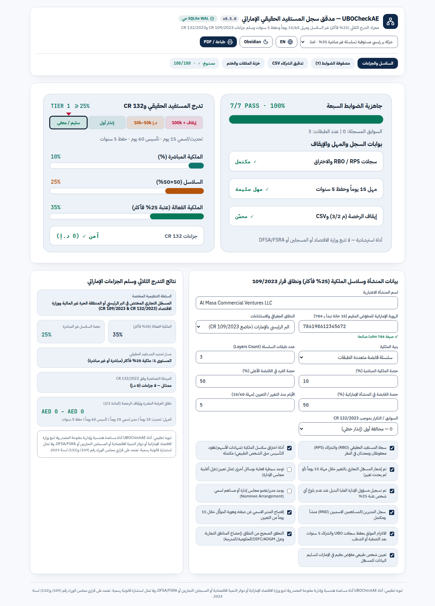
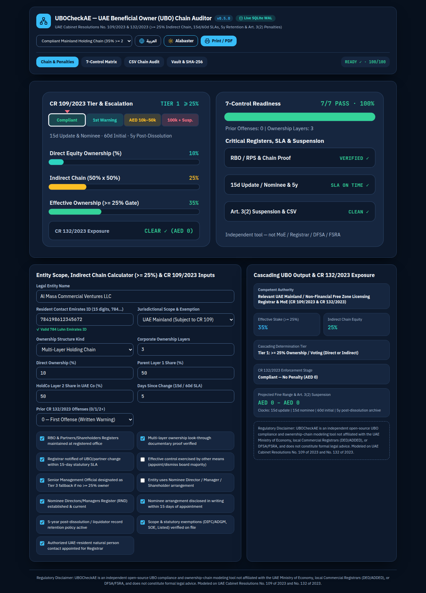
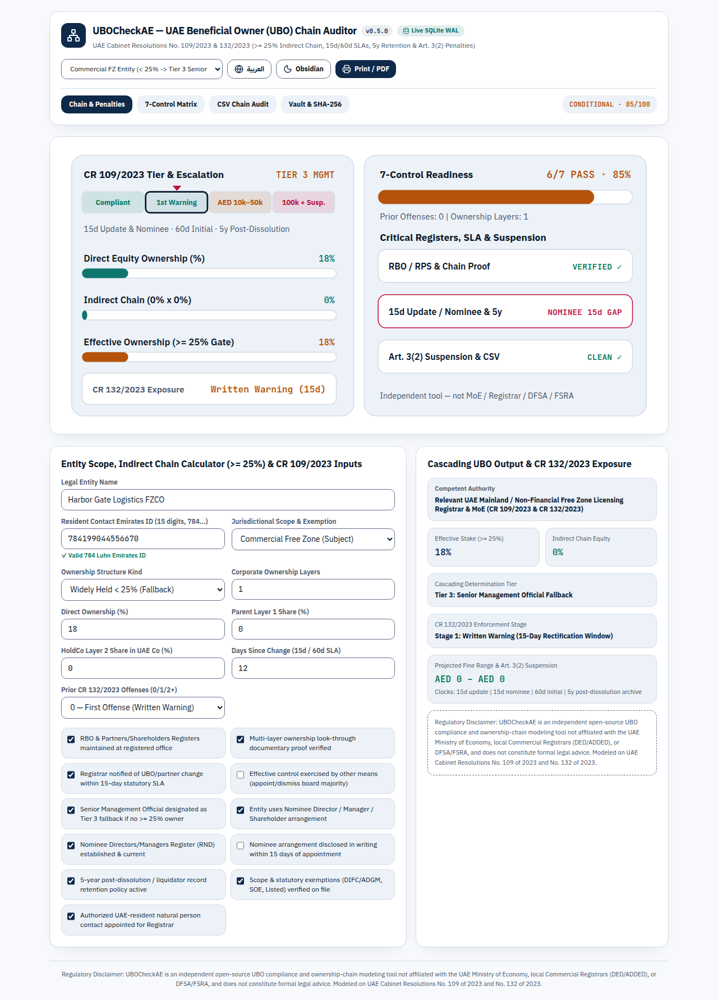
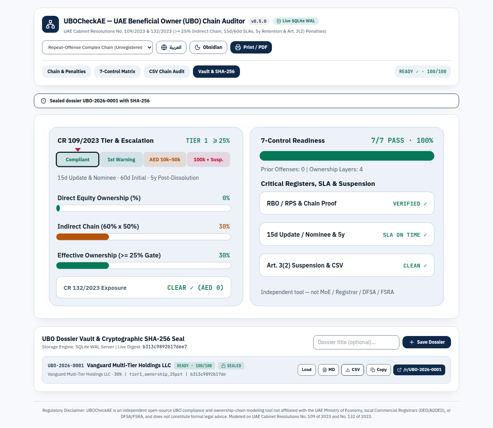
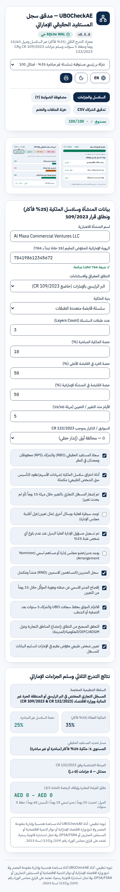
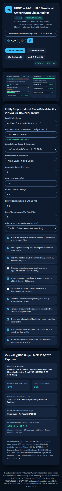

# UBOCheckAE — مدقق سجل المستفيد الحقيقي وسلاسل الملكية والجزاءات الإدارية الإماراتي (`CR 109/2023 & CR 132/2023`)

**UBOCheckAE** is an open-source, bilingual (`AR RTL / EN LTR`) Beneficial Owner (UBO) ownership-chain calculator, statutory register auditor, and escalating penalty simulator built for UAE corporate secretaries, auditors, Corporate Service Providers (`TCSPs`), and enterprises operating under **UAE Cabinet Resolution No. (109) of 2023 Regulating Beneficial Owner Procedures** and **Cabinet Resolution No. (132) of 2023 Regarding Administrative Penalties**.

> **Regulatory Independence Disclaimer:** UBOCheckAE is an independent open-source UBO compliance and ownership-chain modeling tool not affiliated with the UAE Ministry of Economy, local Commercial Registrars (`DED`/`ADDED`), or `DFSA`/`FSRA`, and does not constitute formal legal advice.

---

## Key Capabilities

- **Cascading 3-Tier Test & Indirect Chain Calculator (`src/core/uboEngine.ts`)**:
  - Calculates effective natural-person ownership across multi-layer holding chains (`direct + layer1 x layer2`), enforcing the inclusive **`>= 25%`** capital/voting UBO threshold (**Tier 1**), falling back to control through other means (**Tier 2**), and designating the Senior Management Official fallback (**Tier 3**) when ownership is dispersed.
  - Flags **Complex Cross-Border Ownership Structures (`>= 3` layers)** requiring Registrar look-through documentary proof, tracks **3 mandatory statutory registers** (`RBO`, `RPS`, and `RND` Nominee Directors/Managers), enforces the **`15-day`** Registrar update & nominee disclosure SLAs, **`60-day`** initial window, **`5-year`** post-dissolution/liquidation retention, and correctly scopes **Mainland & Commercial Free Zones** while carving out **`DIFC/ADGM`**, wholly government-owned entities, and regulated listed companies.
  - Models **CR 132/2023** three-stage enforcement: **1st Offense Written Warning (`15-day` rectification)** -> **2nd Offense Monetary Fines (`AED 10,000–50,000`)** -> **3rd/Repeat Offense (`up to AED 100,000` cap + Article 3(2) commercial licence suspension & premises closure)**.
- **Partner & Layer Chain CSV Auditor + `784 Luhn` Verification (`src/core/chainCsvAuditor.ts`)**:
  - Audits multi-layer equity sheets for `>= 25%` indirect eligibility, overdue `> 15-day` updates, undisclosed nominees, and `15-digit` **`784` Luhn** UAE Emirates IDs.
  - Exports spreadsheet-safe **`UTF-8 BOM + CRLF`** CSV files with **`CWE-1236` formula injection neutralization**.
- **Zero-Dependency Node 22 SQLite WAL Backend + `$0` Static Mode (`server/`)**:
  - Persistent `node:sqlite WAL` storage with atomic `UBO-YYYY-0001` dossier numbering, cryptographic `SHA-256` sealing (`409` immutability), bilingual Markdown briefs, and public view-tracked `/r/:slugOrCode` reports — with automatic `$0 localStorage` fallback on Cloudflare Workers (`wrangler.jsonc`).

---

## Visual Verification (`Playwright Chrome E2E`)

Verified across desktop (`1280x800`) and mobile (`390x844`) viewports in both Arabic RTL (`Alabaster Registry`) and English LTR (`Obsidian Compliance`).

| Arabic RTL Desktop (`Alabaster Registry`) | English LTR Desktop (`Obsidian Compliance`) | Tier 3 Senior Mgmt Conditional (`85/100`) |
|---|---|---|
|  |  |  |

| Sealed Dossier (`UBO-2026-0001`) | Mobile Arabic (`390x844`) | Mobile English Obsidian (`390x844`) |
|---|---|---|
|  |  |  |

---

## Quick Start & Verification

```bash
npm install
npm run typecheck
npm test
npm run build
npm run test:e2e
npm start
# Opens HTTP + node:sqlite WAL backend on http://127.0.0.1:4249/ubocheckae
```

See [`launch/DEPLOY-AND-SHARE.md`](launch/DEPLOY-AND-SHARE.md) for `$0` Cloudflare Workers static assets hosting, Docker Compose, and native systemd deployment.

## License

[MIT](LICENSE)
